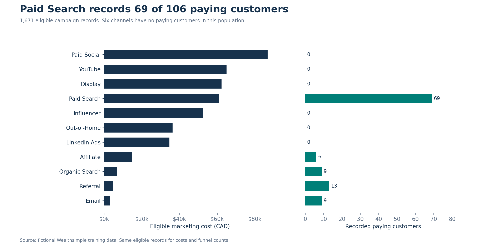

# Wealthsimple Marketing Analytics — Reviewed Analysis and Deliverables

Fictional training data, not actual Wealthsimple business results.

## Analysis

The source contains 2,000 campaign records. A conservative comparison population of 1,671 records has complete, nonnegative and sequential funnel counts, including KYC, and usable marketing costs.

| Metric | Comparable population |
|---|---:|
| Marketing cost (CAD) | 426,714.30 |
| Signups | 13,700 |
| Funded accounts | 1,673 |
| Recorded paying customers | 106 |
| Signup-to-paying rate | 0.77% |
| CAC (CAD) | 4,025.61 |



## Method and limitations

Raw data is preserved. Negative numbers become null, never their absolute values. Missing total cost is reconstructed only when all three components are available. Inconsistent funnel records remain in the dataset with explicit eligibility flags. Costs and customer counts use the same population. Ratios use aggregate numerators and denominators. Zero customers produce undefined CAC.

The sequential funnel assumes each record describes a comparable cohort. This assumption requires validation before real-world use. Counts are recorded events and cannot establish unique acquired people without customer identifiers. Revenue covers only the first month. Zero revenue is not evidence of missing attribution, and revenue less marketing cost is not accounting profit. Campaign IDs map to multiple names in 286 cases, so the composite ID and name is used for detailed grouping. Campaign families are separately defined by channel and name.

Date conflicts with the campaign ID month are retained but excluded from trusted trends. This does not prove which date is correct. There are 102 missing or invalid dates and 107 month conflicts. The supplied date range includes future scenario records and must not be described as completed company performance.

## Reproduce

```bash
pip install -r requirements.txt
python scripts/clean_data.py
python scripts/analyze.py
python scripts/make_charts.py
python -m unittest discover -s tests -v
```

## Files

- `data/raw/`: unchanged input workbook.
- `data/processed/`: cleaned records, field profile, date table and record-level audit log.
- `data/analysis/`: reconciled metrics by channel, campaign, family, objective, product, device, segment and province, plus sensitivity analysis.
- `docs/images/`: seven regenerated analytical charts.
- `scripts/`: portable Python pipeline and category mappings.
- `tests/`: nine integrity and reconciliation tests.

## Deliverables and Power BI status

- [Two-page recommendation report](reports/Wealthsimple_Recommendation_Report.docx)
- [Executive presentation — ten editable slides](reports/Wealthsimple_Executive_Deck.pptx)
- [Power BI source project and Desktop instructions](powerbi/START_HERE.md)
- [55-measure DAX catalogue](powerbi/DAX_Measures.md)
- [Brief compliance and submission checklist](docs/Brief_Compliance.md)
- [Analysis methodology](docs/Analysis_Methodology.md)

The report and executive deck are complete. The Power BI source contains seven pages, native visual definitions, an import model and Power Query transformations. **Desktop execution, interaction checks, remaining visual refinements and the final PBIX save are still pending.** Source-file validation does not establish a working PBIX. Follow the reconciliation checklist before submission.

The Power BI source reads the unchanged Excel workbook through Power Query; the processed Python outputs provide the independent validation baseline. No Power BI Service deployment or public interactive dashboard is claimed.
