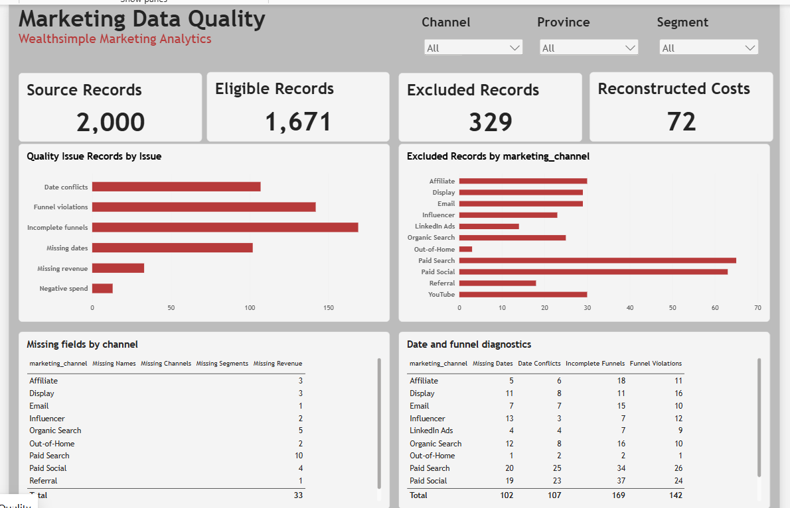
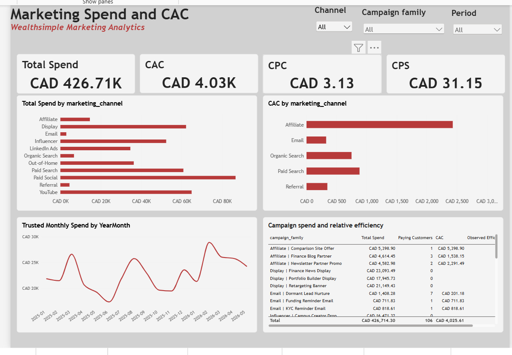
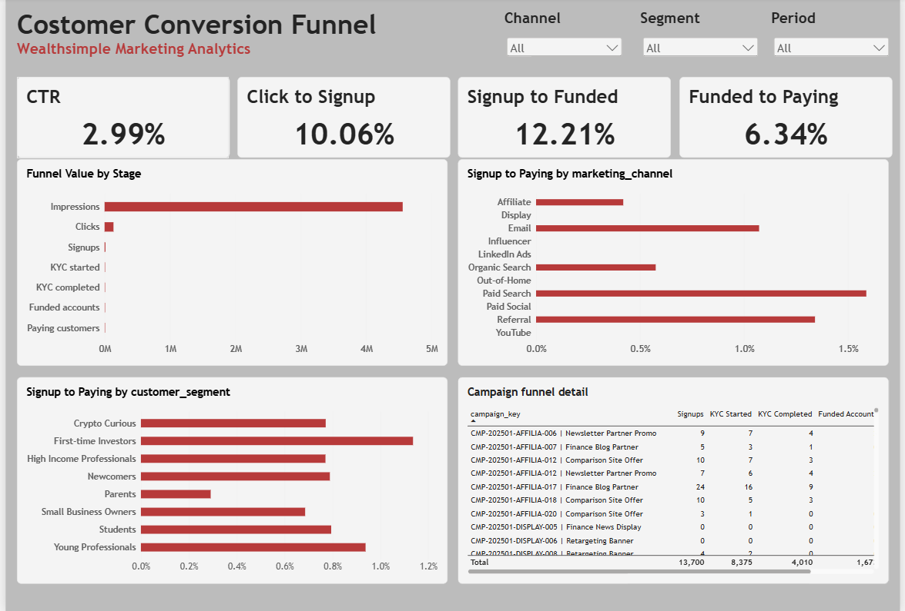
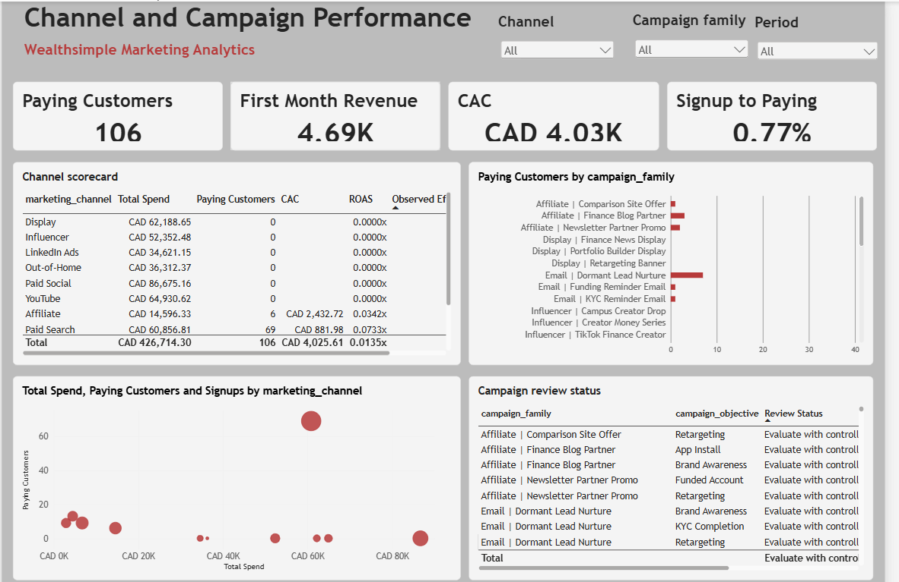
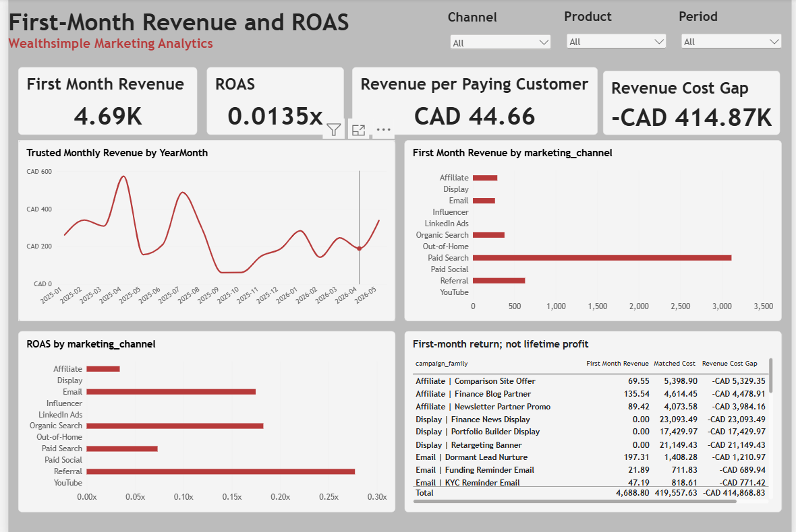
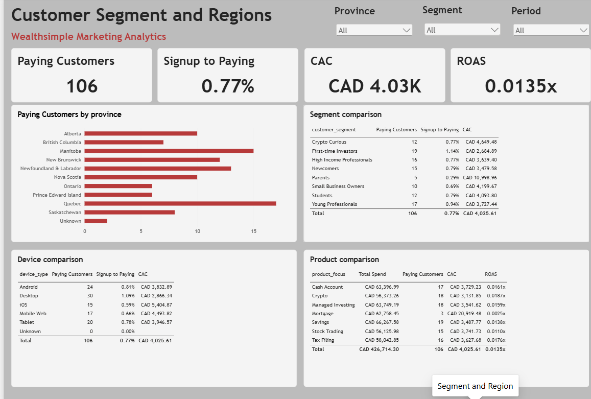
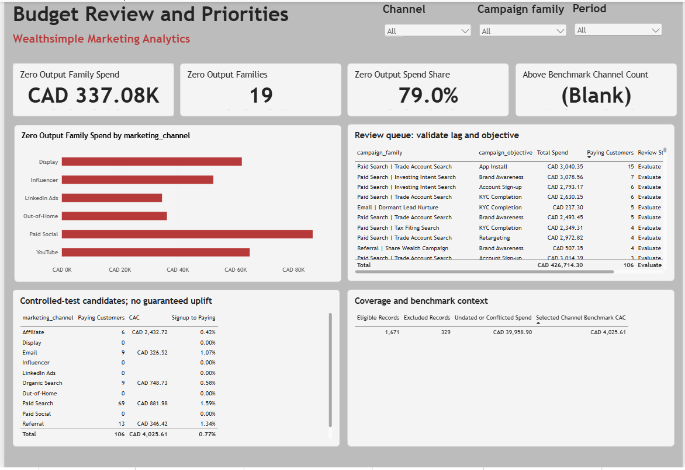

# Power BI dashboard gallery

These are the author's actual Power BI Desktop screenshots submitted on 6 November 2026, preserved without retouching. They show the current local report, including outstanding issues. They are not generated design examples and are not an interactive report.

The seven images show the 7 November Desktop export. The [current editable project](../powerbi/desktop/) includes the revised benchmark calculation. [Open the corrected project](../powerbi/START_HERE.md).

## 1. Data Quality

Source records 2,000; eligible records 1,671; excluded records 329; reconstructed-cost records 72 are visible. Restore the note that issue counts overlap and must not be added. Improve table fit and replace technical field names in titles.

## 2. Spend and CAC

The table displays CAD 426,714.30 spend, 106 recorded paying customers and CAD 4,025.61 CAC. Rounded cards agree. Monthly results are populated. Remove hover controls from the next capture and improve clipped table columns and axis labels.

## 3. Conversion Funnel

The four rate cards show 2.99%, 10.06%, 12.21% and 6.34%. Correct the title from “Costomer” to “Customer”. Impressions dominate the stage chart: use a readable stage-count table or a separately labelled downstream view while retaining all stages and their definitions.

## 4. Channel and Campaign

Customer counts, channel scorecard, campaign ranking and scatterplot render. Widen the review-status column; sort campaign rankings by the relevant measure. The scatterplot describes association, not causal response to spending.

## 5. Revenue and ROAS

The screenshot shows CAD 4,688.80 first-month revenue, 0.0135x ROAS, CAD 44.66 revenue per matched paying customer and a negative revenue–marketing-cost gap. ROAS uses matched **ad spend**, while the gap uses matched **total marketing cost**; these are different denominators. Add CAD to the revenue card and retain the warning that first-month return is not lifetime profit. Full formula reconciliation remains pending.

## 6. Segment and Region

Province, segment, device and product comparisons render. Suggested title: “Customer Segments and Regions”. Retain unknown categories and customer counts alongside rates. Remove the tab tooltip from the next capture and improve table text size.

## 7. Budget Optimization

The archived capture shows CAD 337.08K, 19 families and 79.0% share in the first three cards. The fourth card appeared blank because no channel with a defined CAC exceeded the pooled CAD 4,025.61 benchmark. The revised measure returns 0 for this comparison and stays blank if the selected data has no paying customers. [Filter checks and expected values](Budget_Benchmark_Checks.md).

## Screenshot provenance
- [Source names, byte sizes and SHA-256 hashes](screenshots/manifest.json)
- Original screenshot pixels are preserved, including editor/hover artefacts and scrolling/clipped content.
- Screenshots demonstrate rendering and selected visible values, not every filter interaction, row, formula or refresh scenario.

